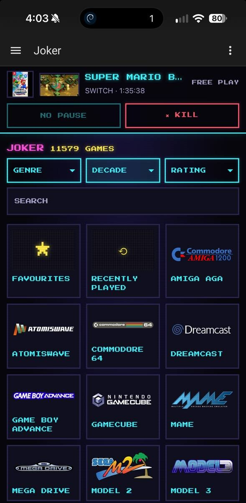
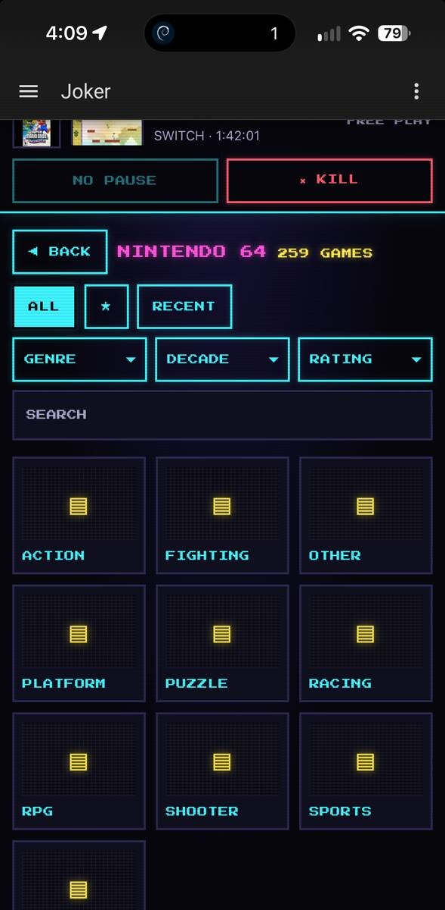
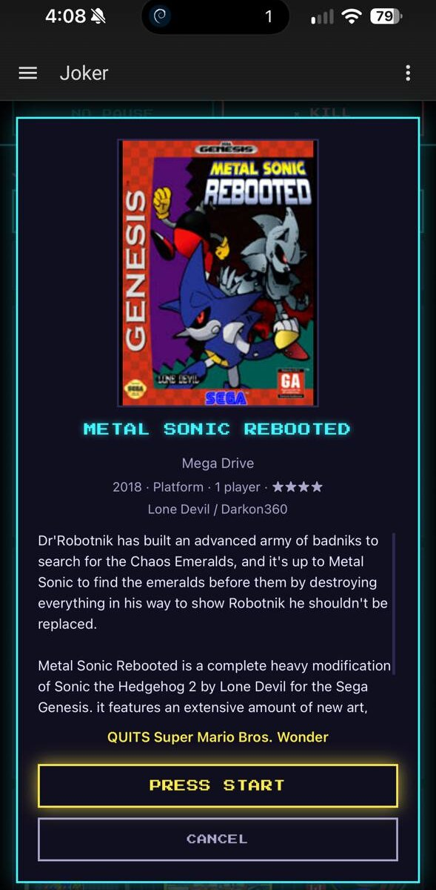
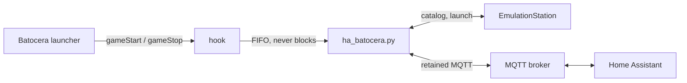

# ha-batocera

Your [Batocera](https://batocera.org) retro-gaming box in
[Home Assistant](https://www.home-assistant.io): search its games from your
phone and launch them on the TV, see what gets played and for how long, watch
the TV live, quit a stuck game, and set daily playtime limits.

<p>
  
  
  
  
  
  
  
</p>

[](https://my.home-assistant.io/redirect/hacs_repository/?owner=vjt&repository=ha-batocera&category=integration)

## What you get

- **A Batocera page** in Home Assistant's sidebar: the box's games with their
  covers, favourites, recently played, one tile per system and per ROM folder
  (ROMs sorted into folders, by genre or anything else, are browsed as such),
  a search that works at every level, and the games filtered by genre,
  decade and rating, in a system or across all of them. Each place says how
  many games it holds, and a search or the filters how many they found. Tap a
  game to see what it is (year, genre, players, rating, who made it, how much
  it was played, its description), PRESS START, and it starts on the TV.
- **What is playing**: game, system, emulator, cover, since when, and the
  minutes played today.
- **The TV screen**, menus included: a screenshot every 15 seconds, and live
  while someone watches it.
- **Stop and pause**: stop quits the game the way the exit hotkey does, so
  saves are written; pause is offered when the emulator has a pause hotkey.
- **Limits**: a daily playtime cap, a time window in which games are allowed,
  a manual lock, and a warning five minutes before the end. Batocera has no
  user profiles, so limits apply to the whole box.

It is two parts, both in this repository: a Home Assistant integration
(`custom_components/batocera/`) and a small daemon for the box (Python 3,
standard library only), which ships inside the integration. They talk over
MQTT; the daemon uses the `mosquitto_pub` and `mosquitto_sub` clients
Batocera already has, and EmulationStation's web API on the box's own
loopback address only. How it works, the MQTT topics and the tests are in
[docs/internals.md](docs/internals.md).



## Install

You need an MQTT broker that the box can reach, Home Assistant's
[MQTT integration](https://www.home-assistant.io/integrations/mqtt/) connected
to it, and a Batocera release that has `batocera-services` (user services in
`/userdata/system/services`). Each box is one entry of the integration.

**1. The integration.** With [HACS](https://hacs.xyz), use the button above,
or: HACS, three dots menu, Custom repositories, add
`https://github.com/vjt/ha-batocera` with type Integration. Install
"Batocera" and restart Home Assistant. Without HACS, copy
`custom_components/batocera/` into your configuration's `custom_components/`
and restart.

**2. The daemon on the box, from Home Assistant.**

[](https://my.home-assistant.io/redirect/config_flow_start/?domain=batocera)

Settings, Devices & services, Add integration, "Batocera", then "Install
ha-batocera on the box". Give the box a name (its topics go under
`batocera/<name>`), its host name or address, and its root password
(Batocera's default is `linux`). Home Assistant connects over SSH as root,
trusts the box's host key from then on, installs a key of its own, sets up
MQTT for the box, runs the installer, and checks from the box that the daemon
reaches the broker. The root password is not stored.

The box gets an MQTT account of its own, never Home Assistant's, which
usually has far more rights than a box needs:

- **With the Mosquitto broker add-on** behind Home Assistant's MQTT
  integration, there is nothing to answer. Home Assistant adds the login
  `batocera-<name>`, with a random password, to the add-on's options and
  restarts the add-on: devices on MQTT reconnect within seconds. Deleting the
  box from the integration removes the login.
- **With any other broker**, create an account for the box on it, and fill
  in the form's Advanced section: the broker's host and port as the box
  reaches them (an address on your network, not `core-mosquitto` or
  `localhost`), and the account. If the broker uses ACLs, the account needs
  the rights listed under [MQTT topics](docs/internals.md#mqtt-topics).

With Advanced left empty, Home Assistant looks for the broker from the box:
at the address in Home Assistant's MQTT integration, unless only Home
Assistant can resolve it (`core-mosquitto`, `localhost`), then at Home
Assistant's own address as the box sees it, then at `homeassistant.local`.
Without the add-on, a broker found this way is used only if it lets the box
in without an account; if it wants one, the form comes back with its address
filled in under Advanced. A broker that Home Assistant reaches over TLS is not
looked for: fill in Advanced with a listener the box can use, or install the
daemon yourself (2b) and add the TLS options to its broker settings.

Home Assistant then keeps the daemon up to date: when the box comes online and
no game is running, it reinstalls the daemon if the versions differ. A game in
progress is never interrupted. Problems (a failed update, a box presenting a
different SSH host key) show up under Settings, Repairs; Reconfigure on the
box, with the root password, sorts them out.

**2b. Or install the daemon yourself**, if you would rather not give Home
Assistant root on the box. As root on the box, with [`get.sh`](get.sh), which
downloads this release from GitHub over HTTPS and runs the installer:

```sh
curl -fsSLo /tmp/ha-batocera-get.sh https://raw.githubusercontent.com/vjt/ha-batocera/v0.7.1/get.sh && sh /tmp/ha-batocera-get.sh
```

Then add the integration in Home Assistant and pick "The box already runs
ha-batocera". Home Assistant does not update a box set up this way: run the
command again to upgrade.

**Uninstall.** On the box, `/userdata/system/ha-batocera/uninstall.sh`
removes the service, the hook, the daemon and Home Assistant's SSH key, and
clears the retained messages. Then delete the box from the integration, which
also removes its login from the Mosquitto add-on, if Home Assistant added one.

## Who may play

Everyone who can open Home Assistant sees the page and browses the games.
**Launching, pausing and stopping** take an admin, or a user picked in the
integration's options ("Who may play"); nobody else by default. This applies
everywhere in Home Assistant, not only to the page. Automations, which run
without a user, are allowed.

## Limits

The limits and the manual lock are set on the box's device page (Settings,
Devices & services, Batocera), and changing them takes an admin. Home
Assistant decides, the box obeys:

- Playtime is counted from the sessions the box reports, and survives
  restarts. A session across midnight counts for the new day from midnight.
- Five minutes before the limit or the end of the window, the integration
  fires a `batocera_warning` event (`entry_id`, `name`, `reason`,
  `minutes_left`), once per game session.
- At the limit, outside the window or under the manual lock, the running game
  is stopped, again every minute while one keeps running. While locked, the
  page shows GAME OVER and launches are refused; a game started on the box
  itself is stopped as soon as it starts, since Batocera ignores the hook's
  exit code.

When "allowed until" is earlier than "allowed from", the window spans
midnight; when they are equal, there is no window. The warning is an event,
so you choose how to deliver it:

```yaml
automation:
  - alias: Batocera, time almost up
    triggers:
      - trigger: event
        event_type: batocera_warning
    actions:
      - action: notify.mobile_app_phone
        data:
          message: >
            {{ trigger.event.data.name }}: {{ trigger.event.data.minutes_left }}
            minutes left.
```

Different limits on different days are an automation that sets
`number.<box>_daily_limit` (or the window) at midnight.

## Entities

For a box named "Arcade":

| Entity | What |
|--------|------|
| `media_player.arcade` | playing / paused / idle / off; title = game, source = system, app = emulator, picture = cover. Browse and play media list and launch the box's games; pause, play and stop work. Attributes: `pausable`, `minutes_left`, `catalog` |
| `image.arcade_screen` | what the TV shows, updated when it changes |
| `binary_sensor.arcade_playing` | on while a game runs |
| `sensor.arcade_game`, `sensor.arcade_system` | the running game and system |
| `sensor.arcade_session_start` | when the running game started |
| `sensor.arcade_playtime_today` | minutes played since local midnight |
| `button.arcade_stop_game` | quits the running game |
| `number.arcade_daily_limit` | daily limit in minutes, 0 = none |
| `time.arcade_allowed_from`, `time.arcade_allowed_until` | the window in which games are allowed |
| `switch.arcade_manual_lock` | locks the box until turned off |
| `binary_sensor.arcade_locked` | on while games are not allowed; attribute `reason`: `manual`, `window` or `limit` |

The entities that mirror the box become unavailable when it is unreachable,
and the media player shows "off" after a clean shutdown. Playtime and limits
stay available.

Each new screenshot is a change of `image.arcade_screen`, which the recorder
keeps like any other. To keep them out of the history, exclude it:

```yaml
recorder:
  exclude:
    entities:
      - image.arcade_screen
```

The live frames are never recorded. `screen_every=0` in
`/userdata/system/ha-batocera/ha-batocera.conf` turns screenshots, and the
live screen, off.

## Security

EmulationStation's web API, with its `PublicWebAccess` setting on, takes
commands on port 1234 from the whole network without authentication: anyone
on the LAN can launch or kill games and send input. ha-batocera uses it from
the box itself only and never changes the setting, but while it is on, Home
Assistant shows a warning under Settings, Repairs with the commands to
restrict it. The installer points out the same, and `es_web_notifier`
(port 8080, same problem).

## Open points

- **Broker unreachable.** The daemon keeps enforcing the last lock it
  received, but starts unlocked until the broker delivers it, and Home
  Assistant cannot stop a game while the broker is down.
- **On-screen warning.** The five-minute warning does not show inside the
  running game.
- **Pause has no feedback.** The pause hotkey toggles and nothing reports
  back: pausing from the pad leaves `paused` wrong until the game ends. Play
  time keeps counting while paused.
- **Gamelists.** Only the `gamelist.xml` next to the ROMs, or in a folder
  above them, is read. Without one, the name is the file name and there is no
  cover.
- **Checked on one box.** The catalog, covers, search, launch, stop and the
  screen are checked on one x86_64 box with Batocera 43. Pause and Kid mode
  are not checked on the box yet. Other releases may answer differently,
  and newer ones may move `hotkeygen`'s hotkeys to D-Bus, which would leave
  pause unknown.

## License

MIT, see [LICENSE](LICENSE).
