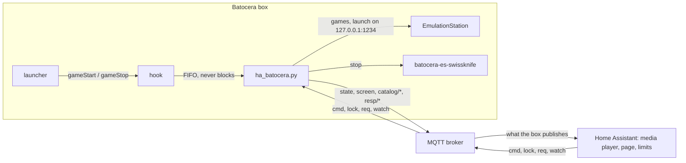

# ha-batocera internals

How the daemon and the integration work, what the installer leaves on the box,
the MQTT protocol between them, and how to run the tests. The
[README](../README.md) covers installing and using it.

## How it works



- Batocera runs every executable in `/userdata/system/scripts/` when a game
  starts and stops. The hook hands the event to the daemon through a FIFO,
  with a one-second timeout, so it can never delay a launch. It passes the
  launcher's pid, and the daemon checks every 15 seconds that it is still
  alive: a crash or a lost stop event still ends the session.
- The game's name and cover come from the system's `gamelist.xml` (box art,
  falling back to the image), as scraped by EmulationStation. Covers are
  downscaled with `ffmpeg` to at most 512 pixels a side.
- Every 15 seconds `grim` takes a screenshot from Batocera's Wayland
  compositor (Batocera 40 and later) and `ffmpeg` scales it down to a
  640-pixel-wide JPEG, both at the lowest CPU priority; it is published only
  when the screen changed. `screen_every=<seconds>` in `ha-batocera.conf`
  changes the interval, `screen_every=0` turns screenshots off.
- While someone watches the live screen, the box sends a 1280-pixel-wide
  frame every second the screen changed. Home Assistant asks for 60 seconds
  of them at a time and renews them while anyone watches; when the last
  viewer leaves, or Home Assistant goes away, they stop within a minute. The
  frames are not retained and go to the open streams only: no entity changes
  and the recorder never sees them. With screenshots off there is no live
  screen either.
- The state is published as retained MQTT messages. A persistent
  `mosquitto_sub` receives commands and holds the MQTT will that marks the box
  offline if the daemon or the network goes away.
- Broker host, port and credentials live in mosquitto client config files
  (mode 600), never on a command line where `ps` would show them.
- `stop` runs `batocera-es-swissknife --emukill`; if the launcher is still
  alive 5 seconds later, the daemon kills its process tree.
- A launch quits the running game first, then asks EmulationStation to launch
  the new one, as if it were picked in its menus: the hook, the lock and the
  limits see an ordinary launch.
- Pause sends the emulator's pause hotkey through Batocera's `hotkeygen`,
  offered when the emulator has one.

## The installer

The installer asks for a device name (used in the topics, default: the
hostname in lower case), the broker host and port, and the MQTT user and
password. It then:

- installs the daemon in `/userdata/system/ha-batocera/`;
- installs the service as `/userdata/system/services/ha_batocera`, enables and
  starts it (it also shows up under System settings, Services, in
  EmulationStation);
- installs the hook as `/userdata/system/scripts/ha_batocera`.

Running it again upgrades the code and keeps the settings. For unattended
installs, settings can be passed in the environment, and then replace the ones
on the box: `DEVICE`, and `MQTT_HOST`, `MQTT_PORT`, `MQTT_USER`,
`MQTT_PASSWORD`. When `MQTT_HOST` is set, nothing is asked about the broker:
without `MQTT_USER` it is reached without authentication.

Files on the box:

| File | Contents |
|------|----------|
| `/userdata/system/ha-batocera/VERSION` | the installed version |
| `/userdata/system/ha-batocera/ha-batocera.conf` | `device=` and, optionally, `topic_prefix=` (default `batocera`) and `screen_every=` |
| `/userdata/system/ha-batocera/mosquitto_pub`, `mosquitto_sub` | broker options, one per line: `-h mqtt.example.lan`, `-p 1883`, `-u user`, `-P password`; TLS options such as `--cafile` work too |
| `/userdata/system/logs/ha-batocera.log` | the daemon's log |

After changing any of them: `batocera-services stop ha_batocera; batocera-services start ha_batocera`.

The installer also points out, without changing them:

- **The wiki's `mqtt_events` script**, which publishes raw events under the
  same `batocera/<host>/` prefix: it prints the commands to remove it and
  clear the retained messages it left.
- **EmulationStation's web API** open to the network (`PublicWebAccess`): it
  prints how to restrict it to the box.
- **`es_web_notifier`**, which listens on port 8080 for the whole network
  without authentication: it prints how to turn it off, if nothing else of
  yours uses it.

### Installed from Home Assistant

Home Assistant connects to the box over SSH as root, with the password:

- it trusts the box's SSH host key from this first connection on (Batocera
  keeps its host keys in `/userdata/system/ssh`, so they survive upgrades);
- it generates an ed25519 key pair of its own and adds the public key to
  `/userdata/system/.ssh/authorized_keys`, root's, with the comment
  `ha-batocera`, replacing the key of any earlier pairing;
- it copies the daemon to the box and runs the installer with the broker
  settings below, the MQTT password on the installer's standard input, never
  on a command line;
- with its own key, it checks the daemon's version, and that the box connects
  to the broker with the files the daemon reads: `mosquitto_pub`, run as the
  daemon runs it, publishes an empty message, not retained, on
  `batocera/<device>/check`.

The broker settings are the ones typed under Advanced, as given. Without them,
Home Assistant looks, from the box, over the same SSH connection and before
anything on the box changes:

- **Where.** In this order, all on the port of Home Assistant's MQTT entry
  (default 1883): the host of that entry, unless it only means something
  inside Home Assistant (`core-mosquitto`, `localhost`, a loopback address);
  Home Assistant's address as the box sees it, the first field of
  `$SSH_CLIENT` (not the local address of Home Assistant's socket, which
  behind Docker's NAT is the container's); `homeassistant.local`. The first
  one the box connects to wins, with an MQTT CONNECT by `mosquitto_pub`, its
  options in a mode-600 file of a private temporary directory, written from
  standard input. A broker Home Assistant reaches over TLS is not looked for.
- **Who.** When Home Assistant runs the Mosquitto add-on (Supervisor) and
  its MQTT entry uses it, Home Assistant adds the login `batocera-<device>`,
  with a random password, to the add-on's `logins` option, through the MQTT
  integration's own add-on manager, leaving the other options as they are.
  It then restarts the add-on and waits until its own MQTT client is
  connected to it again. Removing the entry removes the login, and restarts
  the add-on if it runs. No Home Assistant user is created. With any other
  broker, nothing is created: the box gets a broker only if it needs no
  account.

The errors name the broker tried: `mqtt_refused` (connection refused, or host
not found), `mqtt_timeout`, `mqtt_auth` (user name or password), `mqtt_tls`.
When the check after installing fails, the daemon stays installed with those
settings: installing again overwrites them.

The root password is used for that connection only and is not stored. Home
Assistant keeps the private key, the host key and the name of its add-on
login, if any, in its config entry.

Each time the box comes online, as soon as no game is running, Home Assistant
compares the daemon version on the box with the one it ships. If they differ,
it installs its own and restarts the service, keeping the settings on the
box. A game in progress is never interrupted: restarting the daemon would lose
that session. A failed update is tried again the next time the box comes
online, or when the integration is reloaded.

## MQTT topics

All under `batocera/<device>/` (the prefix is set by `topic_prefix` and
`device` in `ha-batocera.conf`). QoS 1.

| Topic | Retained | Published by | Payload |
|-------|----------|--------------|---------|
| `availability` | yes | box (will) | `online` / `offline` |
| `state` | yes | box | `playing` / `idle` / `off` |
| `game` | yes | box | game name, empty when idle |
| `system` | yes | box | system short name (e.g. `megadrive`), empty when idle |
| `emulator` | yes | box | emulator, or `emulator/core` (e.g. `libretro/genesisplusgx`), empty when idle |
| `started_at` | yes | box | ISO 8601 UTC timestamp of the game start, empty when idle |
| `cover` | yes | box | raw JPEG bytes (at most 512 px a side, 500 KB), empty when there is none |
| `screen` | yes | box | raw JPEG bytes, 640 px wide (at most 500 KB): what the TV shows; empty when there is no screenshot or the box shut down |
| `last_session` | yes | box | JSON: `game`, `system`, `emulator`, `started_at`, `ended_at`, `seconds` |
| `version` | yes | box | the daemon's version |
| `game_id` | yes | box | the running game's id in the catalog, empty when idle |
| `pausable` | yes | box | `ON` / `OFF`: whether the running emulator has a pause hotkey; empty when idle or not known |
| `paused` | yes | box | `ON` / `OFF`, as far as the daemon knows; empty when idle |
| `public_web_access` | yes | box | `ON` / `OFF`: whether EmulationStation's web API is open to the network |
| `catalog/index` | yes | box | JSON: the systems in the catalog, see below |
| `catalog/system/<name>` | yes | box | gzip-compressed JSON: the games of one system, see below |
| `catalog/logo/<name>` | yes | box | raw SVG, PNG or JPEG bytes (at most 256 KB): the system's logo from the theme; empty when there is none |
| `live` | no | box | raw JPEG bytes, 1280 px wide: what the TV shows, while someone watches |
| `cmd` | no | Home Assistant | `stop` |
| `lock` | yes | Home Assistant | `ON` / `OFF` |
| `req` | no | Home Assistant | JSON: a request, see below |
| `watch` | no | Home Assistant | `live`: someone watches, send live frames for 60 seconds; `off`: nobody does |
| `resp/<id>` | no | box | JSON: the answer to request `<id>` |

An empty retained message clears the topic. When a game ends, `last_session`
is published before `state` turns `idle`.

If your broker uses ACLs, the box needs to publish to `batocera/<device>/#`
and to subscribe to its `cmd`, `lock`, `req`, `watch`, `availability` and
`catalog/index` topics; Home Assistant needs to read `batocera/<device>/#` and
to publish `cmd`, `lock`, `req` and `watch`.

### The catalog

The daemon reads the games from EmulationStation's web API, on the box's
loopback address only, and publishes them. Only game systems are listed (no
collections), only the visible ones, and no hidden games; when
EmulationStation is in Kid mode, only the games marked as kid games.

`catalog/index` lists the systems that have games:

```json
[{"name": "megadrive", "fullname": "Sega Mega Drive", "manufacturer": "Sega",
  "year": 1988, "count": 2, "hash": "3f2a9c0e1b7d"}]
```

`hash` changes when the system's games do: a system is published again only
then. `catalog/system/<name>` holds, gzip-compressed, one row per game:

```json
[["9b1c4e0d2a37", "Sonic the Hedgehog", 1991, "Platform", "1", 3, 12, "20261102T183000", "Platform"],
 ["0d5e7a9b3c21", "Streets of Rage", 1991, "Beat'em up", "1-2", 0, 0, "", ""]]
```

That is: id, name, year (or `null`), genre, players, flags, play count, last
played (EmulationStation's local time, or empty), folder. Flags: 1 =
favourite, 2 = has a cover. The folder is where the ROM sits under its
system's ROM folder (`Fighter` for `/userdata/roms/mame/Fighter/kinst.zip`,
`a/b` when nested), empty for a ROM at the top. The id is the first 12 hex
digits of the MD5 of the ROM's path: `game_id` uses the same, so the running
game can be found in the catalog.

The catalog is published when the daemon starts (and again until
EmulationStation answers), after each game (that system only), every 30
minutes while no game runs, and on request. Systems that disappear are
cleared. Covers for it are sent on request, downscaled to 256 pixels at the
lowest CPU priority, and kept by Home Assistant for a week.

### Requests

Home Assistant sends requests on `req`, as JSON with an `id` of 8 to 32
lower-case hex digits and an `op`; the box answers on `resp/<id>`. Requests
bigger than 4 KB, or without a valid id, are dropped.

| `op` | Other fields | Answer when it works |
|------|--------------|----------------------|
| `cover` | `system`, `game` (an id from the catalog) | `jpeg`: the cover, base64, at most 256 px a side |
| `launch` | `system`, `game` | nothing more, once EmulationStation was asked to launch it |
| `pause` | `paused`: `true` or `false` | `paused`: what the daemon believes now |
| `refresh` | none | nothing more; the catalog is read again |

Answers are `{"id": ..., "ok": true, ...}` or `{"id": ..., "ok": false,
"error": ...}`, where the error is one of `bad_request`, `unknown_game`,
`no_cover`, `locked`, `busy`, `not_playing`, `not_pausable`,
`es_unreachable` or `failed`.

The box launches only games from its own catalog: a request names a game by
its id, never by a path. It refuses to launch while the lock is on. A launch
first quits the running game, as `stop` does, and waits for EmulationStation
to be idle again.

Pause sends the emulator its pause hotkey through Batocera's `hotkeygen`.
The hotkey toggles, and the emulator says nothing back: `paused` is the
daemon's belief, not a measurement.

## Development

Daemon tests, standard library only, need `ffmpeg` and `ffprobe` for the cover
tests (they are skipped otherwise):

```sh
python3 -m unittest discover -s tests/daemon -v
```

Integration tests, with
[pytest-homeassistant-custom-component](https://github.com/MatthewFlamm/pytest-homeassistant-custom-component)
(last run with 0.13.375, that is Home Assistant 2026.10.4) and the
integration's requirement from `manifest.json`, in a throwaway container. SSH
is faked: they never connect anywhere.

```sh
docker run --rm -v "$PWD":/src:ro python:3.14-slim sh -c '
  pip install -q pytest-homeassistant-custom-component asyncssh==2.24.0 &&
  cp -r /src /repo && cd /repo && python -m pytest -p no:cacheprovider'
```

The page's card, in [jsdom](https://github.com/jsdom/jsdom), also in a
throwaway container:

```sh
docker run --rm -v "$PWD":/src:ro node:22-slim sh -c '
  cp -r /src /repo && cd /repo/tests/card && npm install --silent && npm test'
```

`custom_components/batocera/daemon/VERSION` must equal the `version` in
`manifest.json`, and `get.sh` and the README must fetch the matching `v` tag
(a daemon test checks all three): Home Assistant reinstalls the daemon on
boxes that report another version, so bump them together for every release,
and tag it.
